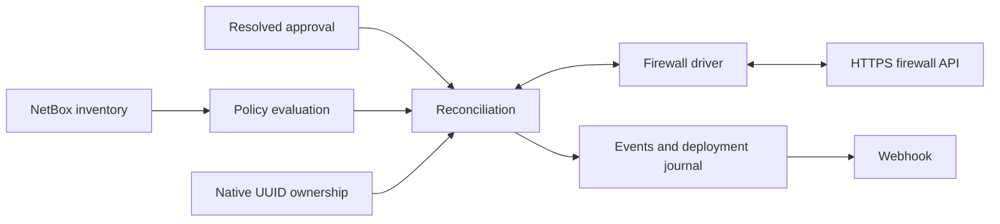

# Architecture

## Selectors

An address group is a JSON object. List items in each term use OR. Machine filters use AND across keys. Device and VM families are evaluated independently. The union of eligible machine selections, explicitly selected interfaces, IP addresses, prefixes and literals forms the group.

| Term | Value and interpretation |
| --- | --- |
| `networks` | List of literal host addresses or canonical prefixes |
| `prefixes` | NetBox Prefix IDs in the configured VRF with active status |
| `ip_addresses` | NetBox IPAddress IDs assigned to eligible device or VM interfaces |
| `devices`, `virtual_machines` | Explicit IDs, optionally constrained by machine filters |
| `interfaces`, `vm_interfaces` | Explicit interface IDs, combined with the required service IP tag |
| `tags` | Host tag slugs |
| `roles`, `sites`, `tenants` | Integer NetBox IDs, including explicit VM site assignment |
| `vlans` | Untagged VLAN IDs for eligible machine interfaces |
| `service_ip_tag` | IP address tag slug required for machine and interface selectors |

The preferred source for a machine is one explicitly tagged service IP per policy address family. Machine primary IPs play no role. Missing or multiple candidates, stale assignments, management-only interfaces, overlapping duplicate addresses with different identities, and wrong VRFs fail evaluation. Explicit prefixes must match family, VRF and scope. The effective group has at most 500 members. The policy engine requires IPv4 prefixes of /16 or narrower and IPv6 prefixes of /48 or narrower and restricts them to operator-defined scope bounds.

Approval fingerprints include selector inputs, service and enforcement semantics, resolved network values and inventory assignment identities. Changing a selector, matching member or address assignment requires review of the new resolution. An approval opens only that exact revision. The worker re-evaluates it before writing. Newly tagged inventory automatically becomes eligible for review.

## State and ownership

Each policy binding owns a rule and two deterministic aliases when deployed. This avoids coupling separate policies through an alias whose membership affects multiple rules. NetBox stores the native UUID, desired last-applied configuration and observed normalization fingerprint. Manual marker matches produce a conflict. Policy deletion leaves UUIDs in the ownership table. The initial baseline labels pre-existing manual rules and never grants ownership. Partial operations and configuration drift require operator recovery. Rule updates, rule reordering, direct rule adoption and automatic deletion have no driver operation.

| Finding | Trigger |
| --- | --- |
| Unmanaged | Observed rule has no UUID ownership mapping |
| Acknowledged | An active exception matches the observed fingerprint and has not expired |
| Expired | The rule is still observed after its exception deadline |
| Drift | An owned resource has a different observed configuration fingerprint |
| Missing | A managed UUID disappears from complete inventory |
| Orphaned | A mapped resource no longer has a desired policy because it was removed or disabled |
| Intent changed | A managed rule differs from evaluated intent |
| Retained members | Additive mode retains member addresses outside current approved membership |
| Pending | A validated create or update is waiting for an authorized deployment |
| Approval required | The current exact resolution differs from the latest approval |
| Validation / unsupported / conflict | Input, capability, ownership or ordering prevents writes |
| Error / unknown | Collection or deployment verification failed |

Each firewall and finding key has one record. The first observation sets first-seen. Repeated scans advance last-seen. Changes to the state or payload append history and update last-changed. Findings absent from a complete scan become resolved. Partial scans leave previous findings open. Webhook deliveries carry only NetBox IDs, state and a revision for receiver-side deduplication. The receiver should tolerate repeated delivery. Delivery failures are isolated from reconciliation.

## Background execution

A NetBox system job schedules bounded per-firewall jobs via `enqueue_once`. Manual actions use the same queue and approvals can enqueue immediately after commit. The five-minute default interval also covers inventory edits. PostgreSQL session advisory locks serialize jobs per firewall across workers. A deployment verifies matching read and write inventories, records a durable plan and journals attempts before each remote call. Interrupted runs block writes. Subsequent audits rediscover the configured state and report conflicts before any future attempt can proceed.

OPNsense configuration writes and reloads lack a single transaction across aliases and rules. The driver applies aliases before staging rules. Verification checks the configured model, reload response, changed PF alias tables, and newly loaded rule UUIDs. Generated runtime rules and packet reachability require independent operator validation.
